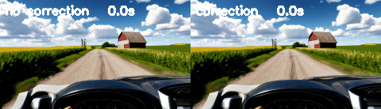
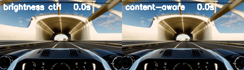
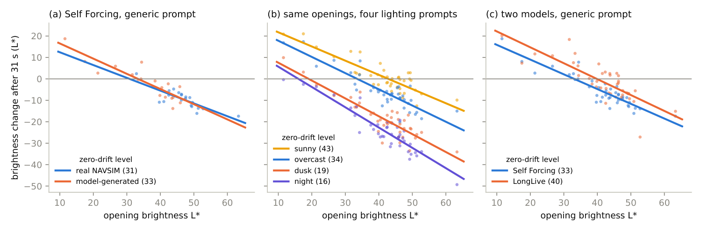
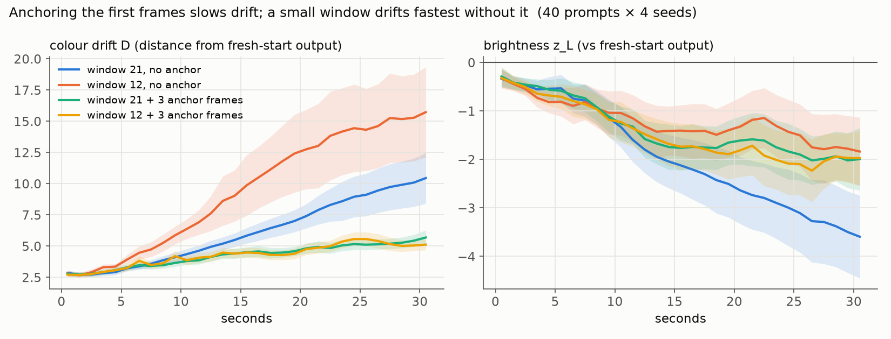
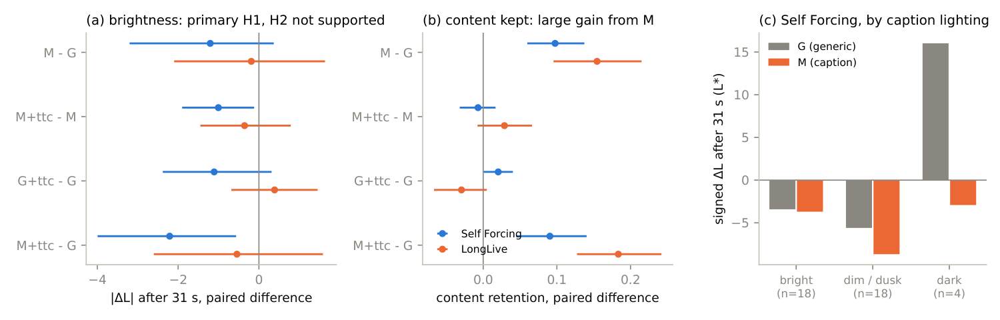
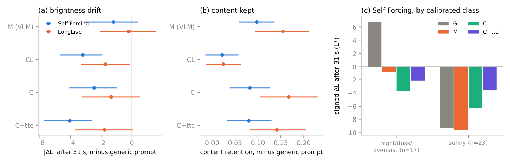

# Drift to Default

**Brightness drift in autoregressive video diffusion is regression to a default level set by the text prompt. This repository measures it, explains it and reduces it without training, using preregistered experiments on two open models.**

[](report/drift_to_default.pdf)
[](docs/README.md#preregistrations)
[](LICENSE)

<p align="center">
  
  
</p>
<p align="center"><sub>Left: one seed without and with the content-aware correction (31 s, Self Forcing). Right: a naive brightness controller lifts a tunnel to overexposure; the content-aware correction keeps it dark.</sub></p>

## Overview

Autoregressive ("causal") video diffusion models such as [Self Forcing](https://github.com/guandeh17/Self-Forcing) and [LongLive](https://github.com/NVlabs/LongLive) generate a video a few frames at a time. Each new chunk is conditioned on the model's own earlier output through a KV cache. This makes long, streaming generation possible, which world models need. Over tens of seconds the picture drifts: it darkens, saturates or loses detail.

This study treats drift as a measurement problem. It uses the design tools of clinical research, which are rare in this field:
- paired seeds;
- prompts held out from development;
- mixed-effects models and cluster-bootstrap confidence intervals;
- analysis plans and code frozen before the data existed.

About **6,800 videos**, most of them 31 seconds long, were generated on a university GPU cluster. No model was trained; everything is inference on public weights followed by measurement.

## Key findings

| | Finding | Evidence | Status |
|---|---|---|---|
| 1 | **Anchoring the first frames slows drift.** An attention sink of 3 frames strongly reduces colour drift. A small rolling window drifts fastest without one. | 2,000 videos, 40 prompts × 4 seeds × 10 context strategies. Sink 3 vs 0: drift D −7.56 [−8.32, −6.81]. Window × sink interaction +5.71 [+4.21, +7.22]. | Preregistered, supported |
| 2 | **Drift is two-way regression to a default brightness, and the prompt sets the default.** Openings brighter than the default darken; darker ones brighten. After 31 s about 22% of the opening's deviation is left. | Brightness change = 22.8 − 0.69 × opening brightness (R² 0.82). Default level by prompt: sunny 43, overcast 34, dusk 19, night 16 L\* (Self Forcing). Same slope on LongLive, different scale: 45, 40, 32, 21. | Exploratory, two models |
| 3 | **A training-free, content-aware correction reduces drift without structural harm.** It keeps legitimate changes such as entering a tunnel. | 40 held-out prompts × 4 seeds: D −1.48 [−1.76, −1.19]. Structure drift non-inferior. 83–93% of legitimate brightness transitions kept. On LongLive about half the effect. | Preregistered, supported |
| 4 | **Describing the opening with a free-form VLM caption does not reduce brightness drift**, though it keeps more of the opening's content. | Caption vs generic prompt: −1.21 [−3.09, +0.36] on Self Forcing, −0.19 on LongLive. Content retention +0.10 / +0.15. The captioner calls normally lit scenes "dim". | Preregistered, not supported |
| 5 | **A lighting description chosen from measured brightness does reduce drift**, if it is calibrated to the model. | Self Forcing: −2.45 [−4.08, −1.04] vs generic (−26%, Holm p = 0.013). With the correction: −44% brightness drift, −39% colour shift. LongLive with its own calibration: primary −1.55, n.s.; lighting-only prompt −34% (p = 0.009). | Preregistered, supported on Self Forcing |


<sub>Brightness change after 31 s against the brightness of a held opening frame. (a) Real NAVSIM and model-generated openings fall on one line. (b) Four lighting prompts set four default levels. (c) Two models: same slope, different default.</sub>

## Study design

Every experiment compares arms on the **same openings or prompts, with the same seeds, on the same GPU architecture**. In bf16 the GPU type changes the output; see [Lessons](#lessons-for-evaluating-video-models).

| Part | Question | Design | Videos | Preregistration | Notes |
|---|---|---|---|---|---|
| 1 | How do rolling windows and attention sinks affect drift? | 10 strategies × 40 prompts × 4 seeds, 31 s | 2,000 | [01](docs/preregistrations/01_context_strategies.md) | [02](docs/lab-notes/02_context_strategies_results.md) |
| 2 | Can drift be corrected at inference time? | Developed on 16 prompts, then confirmed on 40 held-out prompts and 8 held-out control prompts with legitimate changes | ~1,200 | [02](docs/preregistrations/02_correction.md) | [03](docs/lab-notes/03_correction_development.md), [04](docs/lab-notes/04_correction_results.md) |
| 3 | What is drift? | Held real (NAVSIM) and generated openings; KV-cache interventions | ~400 | — | [05](docs/lab-notes/05_mechanism_and_real_openings.md) |
| 4 | Does the prompt set the default? Does it replicate? | 40 openings × 4 lighting prompts; LongLive replication | ~1,250 | — | [06](docs/lab-notes/06_prompt_default_and_longlive.md) |
| 5 | Does describing the opening help? | 40 new openings × 5 arms × 2 models | 800 | [03](docs/preregistrations/03_matched_prompts.md) | [07](docs/lab-notes/07_matched_prompts_results.md) |
| 6 | Does a brightness-calibrated description help? | Same openings, 3 new arms, calibrated per model | ~670 | [04](docs/preregistrations/04_calibrated_lighting.md), [05](docs/preregistrations/05_calibrated_lighting_longlive.md) | [08](docs/lab-notes/08_calibrated_lighting_results.md), [09](docs/lab-notes/09_calibrated_lighting_longlive_results.md) |

**Metrics.** For each prompt, 10 fresh 5-second generations define the model's own normal output. Drift is measured against that reference.
- **D:** Mahalanobis distance of per-frame colour statistics (Lab means, saturation, sharpness).
- **K:** DINOv2 nearest-neighbour distance, scaled so that 1 means "as typical as a fresh start".
- **Held-opening experiments:** the brightness change \|ΔL\| and colour shift ΔE between the opening and the last 2 seconds.

## Results

### Context strategies (Part 1)



- Anchoring cuts colour drift, with a dose effect: 3 frames > 1 > 0.
- Window size matters only without anchoring.
- Re-aligning the sink's RoPE positions, as Rolling and Deep Forcing do, did not help on Self Forcing, which was not trained for it.
- Anchoring slows darkening but does not stop it.

### The correction (Part 2)

At denoising step 1 of 4, the noisy chunk is run once more with a temporary KV cache that holds only the anchor frames. The difference in per-channel spatial means (the "DC" tone) between that prediction and the real one is added back, scaled by β. Layout, detail, the main KV cache and the random stream are unchanged. The cost is one extra forward pass per chunk.

The denoising step works as a knob between drift removal and content fidelity:

| Correction step | Legitimate transitions kept |
|---|---|
| 0 | 56% (also erases tunnels and dusk) |
| 1 | 92% |
| 2–3 | no effect |

A statistical closed-loop controller was tried first and failed; [lab note 03](docs/lab-notes/03_correction_development.md) documents why.


The cost is flicker: jitter rises ×1.13 at β = 1 and ×1.67 at β = 1.5.

### Matching the prompt to the opening (Parts 5–6)



Part 5: a prompt written from a Qwen2.5-VL caption of the opening keeps the scene but not its brightness. The captioner describes about half of the normally lit frames as "dimly lit, early morning or late evening". Under such a prompt those videos darken more (panel c).



Part 6: choosing the lighting description from measured brightness fixes this on Self Forcing. The calibration is model-specific: "dusk" settles at 19 L\* on Self Forcing and 32 on LongLive. On LongLive, the lighting-only calibrated prompt helps (−34%). Adding the VLM scene phrase cancels the gain, probably because that phrase brings its own weather words.

## Claims that did not hold

We report claims made during the study that were later revised or withdrawn after further checks. Details are in [lab note 05](docs/lab-notes/05_mechanism_and_real_openings.md).
- **"The sink works by stabilising the default level."** Withdrawn: trend difference +0.5 [−2.4, 3.5].
- **"The model follows its recent context about 75%."** True only for an artificial tone shift; for natural differences it is 90–100%.
- **Forecasting the final brightness of a video from its early dynamics.** Out-of-sample forecasts were weak.
- **"MUSIQ rewards collapsed videos."** Seen in the pilot, not replicated; MUSIQ is simply insensitive to this drift.
- **"Describing the opening is enough."** Not supported (Part 5).

## Lessons for evaluating video models

- **The GPU architecture changes the video.** With bf16, the same seed gives bit-identical output within an architecture but different videos on A40, A100/A800 and L40S/RTX 6000 Ada. Paired comparisons must pin the architecture. In Part 1, about 70% of the pairs were not strictly paired; later parts pin it and verify by bit-exact reruns.
- **A resumed job can silently break pairing.** A preempted multi-arm job resumed on another GPU type and split 4 openings across architectures. The data were repaired and a sensitivity analysis showed the conclusions unchanged ([lab note 07](docs/lab-notes/07_matched_prompts_results.md)).
- **Common quality metrics miss this drift.** MUSIQ, the model behind VBench's imaging-quality score, is nearly flat across strategies that differ greatly in drift.
- **Prompts, not seeds, carry the variance.** The seed component of end-of-video drift was 0.2 against 13.7 for prompts. More prompts buy more precision than more seeds.

## Reproducing

**Re-checking the published analysis** needs only the summary files in this repository:
```bash
pip install -r requirements.txt
python analysis/verify_preregistration.py   # frozen analysis code matches the preregistered hashes
python report/make_figs.py                  # redraws the report figures from results/
```

**Re-running the generation** needs a GPU:
1. Clone [Self Forcing](https://github.com/guandeh17/Self-Forcing) (tested at commit 33593df). Download `Wan-AI/Wan2.1-T2V-1.3B` and the `self_forcing_dmd.pt` checkpoint, then run `cluster/patch_sf.py` in that repository. The patch adds an SDPA fallback when flash-attention is unavailable, bf16/mmap loading, and optional sink RoPE re-alignment.
2. For LongLive, clone [LongLive](https://github.com/NVlabs/LongLive), download `Efficient-Large-Model/LongLive-1.3B`, and run `cluster/setup_ll.sh` / `cluster/patch_ll.py`.
3. Environment: `cluster/setup_sf_env.sh` (PyTorch 2.5.1 + cu121, transformers 4.49, pyiqa). It was written for an old-glibc SGE cluster; paths in `cluster/env.sh` are site-specific.
4. Run the scripts in `generation/` from the model's repository root. Each script's docstring gives its arguments. One 501-frame video takes about 3 minutes on an A40, A100 or L40S.

NAVSIM / nuPlan camera frames used as real openings are not redistributed. `prompts/` lists the log and frame for each.

## Repository layout

```
generation/   video generation with context strategies, the correction hook, held openings, KV-cache
              interventions, VLM captions, DINOv2/MUSIQ features, latent brightness probes
analysis/     one script per experiment (preregistered ones frozen), opening selection, verify_preregistration.py
prompts/      all prompt sets, including the caption and calibrated-lighting prompts
results/      summary tables, JSON and figures for every experiment (index: results/README.md)
report/       technical report (LaTeX + PDF) and the script that draws its figures
docs/         preregistrations and lab notes (index: docs/README.md)
cluster/      environment setup and runtime patches for the SGE cluster
tools/        GIFs and contact sheets
```

## Limitations

- Both models share the Wan2.1-1.3B base, and videos are 31 seconds long.
- Real openings are single held frames, not real video.
- The correction acts on colour and brightness only. Structural degradation late in a video, such as sky textures, remains.
- The lighting calibration has four discrete levels. Openings brighter than the sunny level (about 43–45 L\*) have no matching description.

## Related work

Self Forcing ([arXiv:2506.08009](https://arxiv.org/abs/2506.08009)) and its long-video successors use rolling windows, sinks and re-aligned positions: Self-Forcing++, LongLive, Rolling Forcing and Deep Forcing ([arXiv:2512.05081](https://arxiv.org/abs/2512.05081)). This study measures those choices with uncertainty. The correction is closest to Pathwise Test-Time Correction ([arXiv:2602.05871](https://arxiv.org/abs/2602.05871)) and FreqForcing ([arXiv:2607.27110](https://arxiv.org/abs/2607.27110)); it is a simplification that transfers only the DC tone at one early step. Also related are ID-Forcing ([arXiv:2610.03120](https://arxiv.org/abs/2610.03120)), Stable Video Infinity, MotionStream and Meta-ARVDM ([arXiv:2503.10704](https://arxiv.org/abs/2503.10704)). A literature review up to October 2026 is in [lab note 00](docs/lab-notes/00_literature_review.md).

## Citation

```bibtex
@misc{wang2026drifttodefault,
  title  = {Drift to Default: Brightness Drift in Autoregressive Video Diffusion Is Regression to a Prompt-Set Level},
  author = {Wang, Yilin},
  year   = {2026},
  url    = {https://github.com/ElaineYilinW/drift-to-default}
}
```

## License and acknowledgements

The code in this repository is released under the [MIT License](LICENSE). It drives and patches [Self Forcing](https://github.com/guandeh17/Self-Forcing) and [LongLive](https://github.com/NVlabs/LongLive). It also uses [Wan2.1](https://github.com/Wan-Video/Wan2.1), [DINOv2](https://github.com/facebookresearch/dinov2), [pyiqa](https://github.com/chaofengc/IQA-PyTorch) and [Qwen2.5-VL](https://github.com/QwenLM/Qwen2.5-VL), each under its own licence. NAVSIM / nuPlan images are not redistributed. Computation ran on the University of Iowa Argon cluster.

This is an independent study and is not affiliated with any company.
