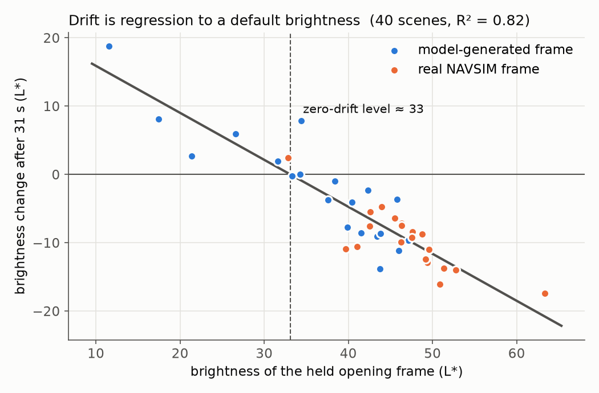
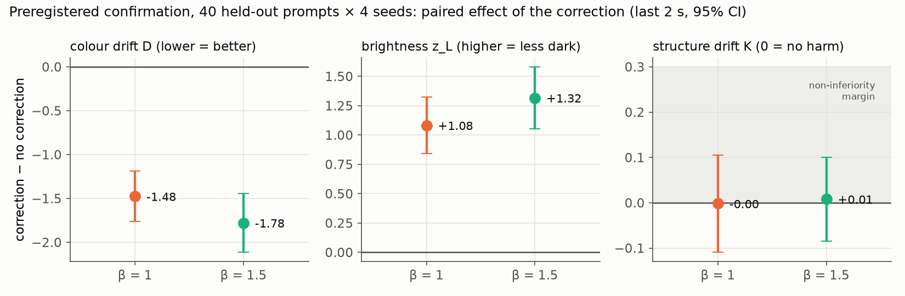
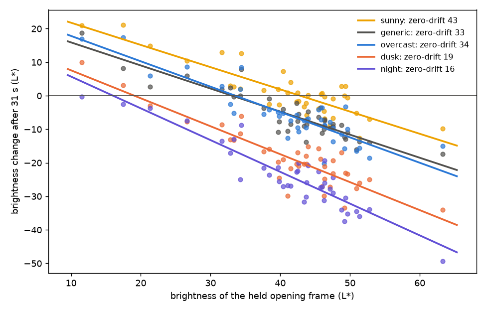
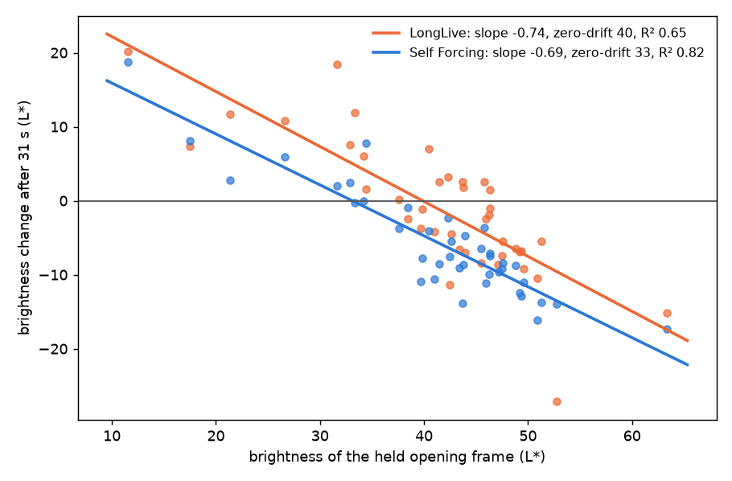
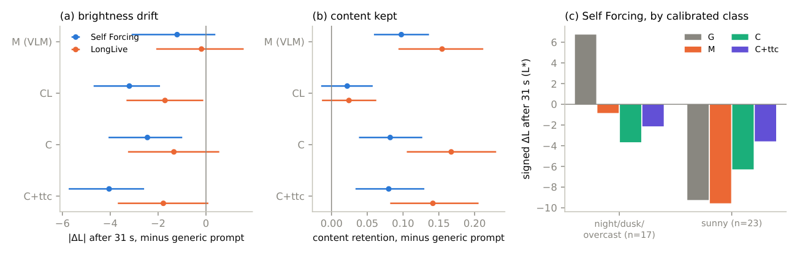

# drift-to-default

**Colour drift in autoregressive video diffusion is regression to a default brightness set by the text prompt — measured, explained and corrected on Self Forcing (Wan2.1-1.3B) with preregistered experiments, and replicated on LongLive.**

Autoregressive ("causal") video diffusion models generate long videos chunk by chunk, conditioning on their own past output through a KV cache. Over tens of seconds the picture drifts: it darkens, saturates or falls apart. This repository is an empirical study of that drift on the open [Self Forcing](https://github.com/guandeh17/Self-Forcing) model, with a replication on [LongLive](https://github.com/NVlabs/LongLive). It generates about 6,400 videos (mostly 31 s long) on a university HPC cluster and analyses them with the kind of design and statistics that are standard in clinical research but rare in this field: paired seeds, mixed-effects models, cluster-bootstrap confidence intervals, held-out prompts and frozen preregistrations.

No model was trained. Everything is inference on public weights plus measurement.

  
  

Left: the same seed without and with the correction (31 s). Right: a naive brightness controller lifts a dark tunnel to overexposure; the content-aware correction keeps it dark.

## Findings at a glance

| | Finding | Evidence | Status |
|---|---|---|---|
| 1 | **Drift is two-way regression to a default brightness.** Openings brighter than the default darken, darker ones brighten. | 40 held opening frames: brightness change after 31 s = 22.8 − 0.69 × opening brightness, R² = 0.82, slope 95% CI [−0.79, −0.58]. Different seeds of a prompt regress to a common level (persistence of an early deviation only 0.1–0.3). | holds |
| 1b | **The default is set by the prompt.** The same 40 openings continued under four lighting prompts regress to different levels: sunny 43, overcast 34, dusk 19, night 16 (the generic prompt: 33). | 320 videos; ANCOVA lighting term p ≈ 5 × 10⁻⁷⁸, common slope −0.78 [−0.83, −0.72] (only ~22% of the opening's brightness survives 31 s). | exploratory |
| 1c | **The same law holds on a second model (LongLive 1.0)** with the same slope but a brighter default. | slope −0.74 [−1.01, −0.58] vs −0.69; zero-drift level 40 [38, 42] vs 33 [30, 35]; R² 0.65. | exploratory |
| 2 | **Anchoring the first frames (attention sink) slows drift; a small rolling window drifts fastest without it.** | Preregistered factorial study, 40 prompts × 4 seeds × 10 context strategies: colour drift D, sink 3 vs 0: −7.56 [−8.32, −6.81]; window × sink interaction +5.71 [+4.21, +7.22]. | holds (preregistered) |
| 3 | **A training-free, content-aware correction reduces drift without harming structure** and keeps legitimate brightness changes such as entering a tunnel. | Preregistered confirmation on 40 held-out prompts: D −1.48 [−1.76, −1.19] (β = 1) and −1.78 [−2.11, −1.45] (β = 1.5); structure drift non-inferior; 83–93% of legitimate brightness transitions kept on held-out control prompts. | holds (preregistered) |
| 4 | **The correction also works when continuing a real driving frame** (NAVSIM front camera), and on Self Forcing real frames darken more only because they are brighter. | 20 real scenes: colour shift from the opening 10.7 → 8.1 / 7.8; real vs model-generated opening differs by p = 0.80 once opening brightness is controlled (on LongLive real openings darken 4.3 L\* more, p = 0.03). | holds (Self Forcing) |
| 4b | **The correction transfers to LongLive** without changes, at about half the effect, because LongLive drifts less on these prompts. | 40 prompts × 2 seeds: D −0.70 [−1.13, −0.27], structure non-inferior, jitter ×1.10; 40 openings: brightness shift 7.4 → 5.2 (30/40 scenes improved). | exploratory |
| 5 | **Observational estimates give the wrong causal answer.** | A regression-derived "brightness direction" in latent space realises 18% of an intended change, a direction estimated from designed per-channel perturbations realises 96%. An observational AR slope is 0.50 where interventions give 0.76–0.99. | holds |
| 6 | The model follows the brightness of its recent context about 90–100% for natural differences, but only about 75% for an artificial tone shift. The first frames have a tiny direct effect (0.036) yet reduce drift. | Context-intervention experiments (KV-cache replay, bit-exact). | revised wording; mechanism of anchoring open |
| 8 | **Describing the opening in the prompt (off-the-shelf VLM caption) does not reliably reduce brightness drift**, but it keeps much more of the opening's content. | Preregistered, 40 new openings × 2 models × 5 arms (800 videos): \|ΔL\| caption vs generic −1.21 [−3.09, 0.36] (Self Forcing), −0.19 [−2.00, 1.63] (LongLive), not supported; content retention +0.10 / +0.15 (p < 0.001). The captioner calls half of normally lit frames "dim", which pulls them darker. | **negative (preregistered)** |
| 9 | **A lighting description chosen from the opening's measured brightness does reduce drift** (Self Forcing), and with the correction cuts brightness drift by 44%. | Preregistered, 560 new videos, strictly paired (80/80 bit-identical reruns): \|ΔL\| calibrated vs generic −2.45 [−4.08, −1.04], Holm p = 0.013 (Self Forcing); LongLive −1.34, n.s. (calibration estimated on Self Forcing is biased there). Calibrated vs VLM caption −1.2 on both, n.s. | **holds on Self Forcing (preregistered)** |
| 7 | ~~Anchoring works by stabilising the default brightness.~~ ~~A simple dynamics model forecasts the final brightness.~~ | Trend difference +0.5 [−2.4, 3.5]; out-of-sample forecasts weak. | **withdrawn** |

## Part 1 — How context strategies affect drift (preregistered)

Self Forcing keeps a rolling KV cache of 21 latent frames and can keep the first frames permanently (an "attention sink"). We crossed window size {12, 21} × anchored frames {0, 1, 3} × RoPE re-alignment of the anchor {no, yes} — 10 strategies — over 40 prompts (20 MovieGen, 20 driving) × 4 seeds, 501 frames each, with a frozen analysis plan ([docs/preregistration_cn.md](docs/preregistration_cn.md)).

Metrics are self-referenced: for every prompt, 10 fresh 5-second generations define the model's normal output.
- **D** — Mahalanobis distance of each frame's colour statistics (Lab mean, saturation, sharpness) from that reference;
- **K** — DINOv2 nearest-neighbour distance to the reference frames.

- Anchoring 3 frames cuts colour drift strongly, with a dose effect (3 > 1 > 0). Without anchoring a window of 12 is much worse than 21; with anchoring the window size barely matters.
- Drift is slowed, not stopped: D keeps rising to 31 s. Anchoring fixes over-saturation but not darkening (z_L ≈ −2 in >80% of videos).
- RoPE re-alignment of the anchor (as in Rolling/Deep Forcing) did not help colour on Self Forcing and slightly increased K.
- MUSIQ, the image-quality model behind VBench's "imaging quality" and common drift scores, is nearly flat across strategies (66–69) — it is insensitive to this drift.

## Part 2 — A training-free correction (developed, then preregistered and confirmed)

Developed only on 10 pilot prompts and 6 control prompts whose brightness should change ([docs/correction_dev_cn.md](docs/correction_dev_cn.md), including the failures):

- A **statistical closed-loop brightness controller** (integral control, jump guard, CUSUM trigger) failed. It cannot tell legitimate dimming from drift, it lifted tunnels to overexposure, and its jump guard ratcheted on its own corrections.
- The **content-aware correction** works. At denoising step 1 of 4, the same noisy chunk is run once more with only the clean anchor frames as context. The difference in per-channel spatial means (the "DC" tone) between that prediction and the real prediction is added, scaled by β. Layout and detail are untouched, and the main KV cache and random-number stream are unchanged. It costs one extra forward pass per chunk (~25%).
- **The denoising step is a knob between drift removal and content fidelity.** Correcting at step 0 removes the most drift but also erases tunnels and dusk (~56% of transitions kept). Step 1 keeps ~92%. Steps 2–3 have no effect.

The confirmatory test ([docs/preregistration_correction_cn.md](docs/preregistration_correction_cn.md), [docs/correction_results_cn.md](docs/correction_results_cn.md)) met every preregistered criterion:

Flicker is the cost: jitter ×1.13 / ×1.67 and chunk-boundary jumps ×1.32 / ×2.40 for β = 1 / 1.5. On real openings, flicker did not increase noticeably (×0.88 / ×1.0–1.06).

## Part 3 — Mechanism checks (exploratory)

[docs/swap_real_results_cn.md](docs/swap_real_results_cn.md) records every check and every correction of earlier claims.
- **Context interventions** (`ctx_swap.py`, `ctx_swap2.py`): pause generation, rebuild the KV cache by replaying the stored history with the anchor or the rolling window shifted in brightness (synthetically along a validated latent direction, or naturally by swapping in another seed's window), regenerate the next chunk from the same noise and random state, then restore. Unshifted replays reproduce the original bit for bit.
- **Real vs model-generated openings** (`correct_gen2.py --init_image`): a single frame held for 0.5 s, then continued to 31 s. Real frames are NAVSIM/nuPlan front-camera images (not redistributed here). Model-generated frames come from the main experiment.

## Part 4 — Does the prompt set the default? Does it replicate? (exploratory)

[docs/light_ll_results_cn.md](docs/light_ll_results_cn.md) has the full tables.

**Lighting prompts** (`analyze_light.py`, `prompts/lighting.jsonl`). The 40 held openings of Part 3 were continued for 31 s under four prompts that differ only in the lighting description. Each prompt pulls the video to its own level. "Drift" is better described as the opening frame being forgotten while the text takes over: after 31 s only about a fifth of the opening's brightness deviation is left, and darker prompts regress more completely (slope −0.95 for night vs −0.66 for sunny, interaction p = 0.011). Dusk and night prompts may legitimately ask for darkening, so this measures the prompt's target, not a defect.

**Second model: LongLive 1.0** (`ll_gen.py`; Wan2.1-1.3B + LoRA, official window 12 + sink 3). The same openings regress with the same slope, but to a brighter default (≈40). That is why LongLive seemed hardly to darken real driving frames (mean L\* 47): they start closer to its default. The correction ports directly. On the 40 main prompts it reduces colour drift D by 0.70 (Self Forcing: 1.48 on held-out prompts). β = 1.5 brings no further gain on LongLive.

## Part 5 — Matching the prompt to the opening (preregistered, negative)

If drift is the text overriding the opening, a prompt that describes the opening should drift less. We tested this with a frozen plan ([docs/preregistration_match_cn.md](docs/preregistration_match_cn.md), committed before any video was generated) and report the result in [docs/match_results_cn.md](docs/match_results_cn.md).
- **Design.** 40 new openings: 20 NAVSIM frames spread over brightness and 20 generated frames. Qwen2.5-VL-3B captioned each opening (`caption_vlm.py`). Three prompts: generic (G); scene + lighting from the caption (M); the generic scene with the caption's lighting only (ML). G and M were each run with and without the correction. Two models, 2 seeds.
- **Primary: not supported** on either model (Holm p ≥ 0.14).
- **Secondary:**
  - Content retention improves strongly (+0.10 / +0.15 DINOv2 similarity to the opening).
  - Jitter drops.
  - On Self Forcing, caption prompt + correction vs generic reduces the colour shift ΔE by 2.9.
- **Why (exploratory).** The captioner's lighting words are not calibrated to brightness. Normally lit frames described as "dimly lit … early morning or late evening" darkened *more*. The 4 genuinely dark frames, which the generic prompt brightened by 16 L\*, stayed put under the caption prompt. A brightness-calibrated lighting description is the obvious next test.

## Part 6 — Calibrating the lighting description (preregistered)

Part 5 failed because the caption's lighting words did not match the actual brightness. So the next test chose the lighting description from the opening's measured brightness instead ([docs/preregistration_calib_cn.md](docs/preregistration_calib_cn.md), committed before generation; results in [docs/calib_results_cn.md](docs/calib_results_cn.md)).
- **Rule:** use the Part 4 lighting prompt whose Self Forcing default level is nearest to the opening's brightness.
- **Arms:**
  - CL: generic scene + calibrated lighting.
  - C: VLM scene + calibrated lighting.
  - C + correction.
- **Pairing:** compared against the Part 5 videos on the same GPU architecture; reruns were bit-identical for all 80 openings.
- **Results:**
  - Primary: calibrated vs generic −2.45 L\* on Self Forcing (−26%, Holm p = 0.013). The other three primary tests point the same way but are not significant.
  - Secondary, Self Forcing: calibrated prompt + correction vs generic, brightness drift −44% and colour shift −39%, with more content kept and less flicker.
  - LongLive: the Self-Forcing calibration is biased by +4 L\*, so each model needs its own calibration.

## Practical lessons about evaluating video models
- **A resumed job can break pairing.** Our generators skip outputs that already exist, so a preempted job resumed on a different GPU type and split 4 openings across architectures. Pin each paired job to one architecture.
- **GPU architecture changes outputs.** With bf16, the same seed gives different videos on A40, on A100/A800, and on L40S/RTX 6000 Ada (identical within an architecture). About 70% of the "paired" comparisons in Part 1 were therefore not strictly paired. That does not bias the results, but it loses efficiency. All later experiments pin each prompt to one architecture.
- **Prompts, not seeds, carry the variance.** In Part 1 the seed variance component of end-of-video drift was tiny next to the prompt component (0.2 vs 13.7), so more prompts buy more precision than more seeds. Most published long-video results use one sample per prompt and report no uncertainty.

An 8-page technical report with all parts is in [report/drift_to_default.pdf](report/drift_to_default.pdf).

## Repository layout
| Path | Contents |
|---|---|
| `gen.py`, `features.py`, `stats_util.py` | generation with context strategies; DINOv2 / MUSIQ features; per-frame colour statistics |
| `analyze_pilot.py`, `analyze_main.py` | Part 1 (pilot; frozen preregistered analysis) |
| `correct_gen.py`, `correct_gen2.py` | generation with correction hooks (bit-exact with the official loop when off); v2 adds a real-image opening |
| `latent_summary.py`, `dose_response.py`, `jacobian.py` | latent → brightness: observational fit vs interventional (per-channel) estimate |
| `analyze_e2.py`, `analyze_confirm.py` | correction development; frozen confirmatory analysis |
| `ctx_swap.py`, `ctx_swap2.py`, `analyze_swap.py`, `analyze_real.py`, `analyze_checks.py` | Part 3 mechanism and real-opening experiments |
| `make_calib_prompts.py`, `analyze_calib.py` | Part 6: brightness-calibrated lighting prompts, frozen analysis |
| `caption_vlm.py`, `analyze_match.py`, `jobs/select_openings.py` | Part 5: VLM captions → prompts, frozen analysis, opening selection |
| `analyze_light.py`, `ll_gen.py`, `analyze_ll.py` | Part 4: lighting prompts; LongLive generation with the correction hook (run from the LongLive repo, `jobs/setup_ll.sh`, `jobs/patch_ll.py`); two-model comparison |
| `jobs/` | environment setup on a CentOS 7 / SGE cluster (`setup_sf_env.sh`), runtime patches to Self Forcing (`patch_sf.py`) |
| `prompts/` | all prompt sets (real-frame prompts list the NAVSIM log, not the image) |
| `results/` | summary tables, JSON and figures for every experiment (per-video raw data omitted for size) |
| `docs/` | lab notes in Chinese: literature review, pilot report, preregistrations, results, development log |

## Reproducing
1. Clone [Self Forcing](https://github.com/guandeh17/Self-Forcing) (tested at commit 33593df), download `Wan-AI/Wan2.1-T2V-1.3B` and `gdhe17/Self-Forcing/checkpoints/self_forcing_dmd.pt`, and apply `jobs/patch_sf.py` from the repo root. It adds an SDPA fallback when flash-attention is unavailable, bf16/mmap loading, and optional sink RoPE re-alignment.
2. Environment: `jobs/setup_sf_env.sh` (PyTorch 2.5.1 + cu121, transformers 4.49, pyiqa). It was written for an old-glibc cluster; paths in `jobs/env.sh` are cluster-specific.
3. Run the scripts from the Self Forcing root. Each script's docstring gives its arguments. One 501-frame video takes about 2.5 min on an A40/A100.

Frozen files can be checked against the SHA-256 hashes at the end of each preregistration.

## Limitations
- Two models, both built on Wan2.1-1.3B (Self Forcing, trained without a sink; LongLive). Preregistered results are on Self Forcing only; the lighting and LongLive experiments are exploratory with 2 seeds. 31-second videos.
- The correction fixes colour and brightness only. Structural degradation (e.g. sky textures late in a video) remains.
- The mechanism results are exploratory. How anchoring reduces drift is not explained, and per-video attractor estimates are too noisy for forecasting.
- Real openings are single held frames, not real video.

## Related work
Self Forcing ([2506.08009](https://arxiv.org/abs/2506.08009)), Self-Forcing++, LongLive, Rolling Forcing, Deep Forcing ([2512.05081](https://arxiv.org/abs/2512.05081)), FreqForcing ([2607.27110](https://arxiv.org/abs/2607.27110)), Pathwise Test-Time Correction ([2602.05871](https://arxiv.org/abs/2602.05871)), ID-Forcing ([2610.03120](https://arxiv.org/abs/2610.03120)), Stable Video Infinity, MotionStream, and Meta-ARVDM ([2503.10704](https://arxiv.org/abs/2503.10704)). The correction is closest to Pathwise TTC and FreqForcing; it is a simplification (DC-only transfer at one early step). See [docs/lit_review_cn.md](docs/lit_review_cn.md). Novelty claims here are based on a literature search up to mid-October 2026.

## Acknowledgements and licences
Code in this repository is released under the MIT licence. It drives and patches [Self Forcing](https://github.com/guandeh17/Self-Forcing) and uses [Wan2.1](https://github.com/Wan-Video/Wan2.1), [DINOv2](https://github.com/facebookresearch/dinov2) and [pyiqa](https://github.com/chaofengc/IQA-PyTorch) under their own licences. NAVSIM / nuPlan images are not redistributed. Computation ran on the University of Iowa Argon cluster.

This is an independent study and is not affiliated with any company.
