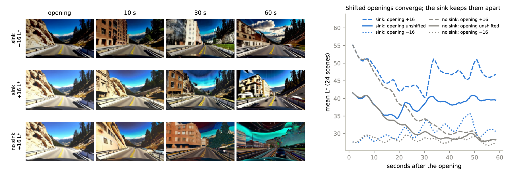
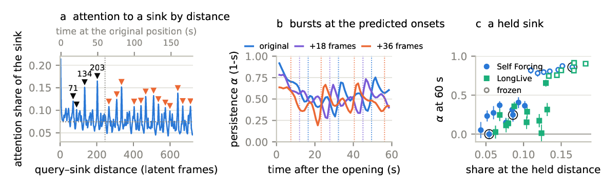
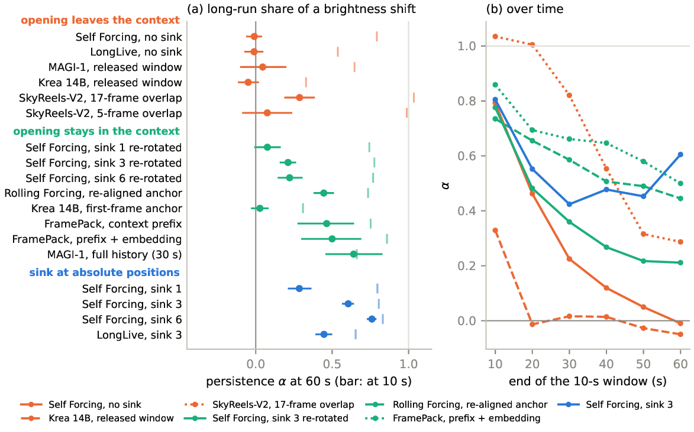

# Drift to Default

**How autoregressive video diffusion models forget their opening, and which training-free settings change that.**

Autoregressive video models generate long videos chunk by chunk, each chunk conditioned on the model's own output, and the picture drifts. This project measures that drift by intervention across nine open-weight models (1.3B to 14B parameters), explains part of it through the attention mechanism, and tests training-free fixes. All 39 studies were preregistered with hashed analysis code; all 145 primary tests are reported, including the 46 that failed.

[Paper draft (PDF)](paper/main.pdf) · [Preregistrations](docs/README.md) · [Results index](results/README.md)


<sub>A generated opening, darkened or brightened by 16 L\*, continued for 60 s by Self Forcing under a generic city prompt, with and without an attention sink. Right: across 24 scenes the three versions converge without a sink and stay apart with one.</sub>

## Method

Hold an opening frame, shift its brightness or colour within a scene, or start from different scene classes; let the model continue; measure how much of the opening survives. The results are summarised by a linear response,

&nbsp;&nbsp;&nbsp;&nbsp;**x(T) ≈ α(T) · x<sub>opening</sub> + (1 − α(T)) · μ**

where **α** is the share of the opening kept at time T and **μ** is the default the conditioning pulls toward. Arms are compared on the same openings and seeds, on one GPU architecture, with cluster-bootstrap intervals.

## Key findings

1. **Every model relaxes toward a conditioning-set default, in tone and in scene content.** Under a generic city prompt, openings of six scene classes lose 39–93% of their CLIP class evidence within 30 s, depending on the configuration. Lighting words alone move the default by up to 27 L\*.
2. **What survives depends on whether the opening stays in the context.** Once it leaves a sliding key–value window it is forgotten, at 1.3B and at 14B parameters. An opening that stays in the context keeps a share: 0.21 for a re-rotated sink, 0.45 for Rolling Forcing and 0.51 for FramePack at 60 s.
3. **Attention sinks produce bursts at positions an attention probe predicts.** With a sink at its absolute RoPE positions, the opening briefly returns where the probe finds attention to the sink peaking. Moving the sink moves the bursts; 13 burst times after 60 s, predicted out of sample, were confirmed on 180-s videos; holding one of the sink's 22 temporal RoPE frequencies removes the bursts in two models.
4. **Drift has two separable parts.** Rollouts forget the opening, and the default itself sits away from where the prompt starts. In Self Forcing without a sink, this offset grows with the key–value window, from 5 L\* at window 6 to 16 L\* at window 21. With LongLive's 12-frame window, Self Forcing's offset halves and no longer differs significantly from LongLive's.
5. **Training-free settings change the drift, each at a cost.** A sink held at a probe-chosen distance (Self Forcing, 120–180 s) keeps 0.45 of the opening's tone [0.40, 0.49] without bursts, against 0.22 for standard re-alignment and 0.43, with bursts, at its original positions. It does not transfer directly: at 60 s the same distance keeps 0.41 on Self Forcing and 0.17 on LongLive. With the distance chosen per model by one rule, the held sink keeps more than a re-aligned sink in four models on new openings (+0.20 to +0.30 at 60–120 s), but on prompt-only videos it does not improve VBench-style imaging quality and the video moves less: it controls how much of the opening is kept rather than improving quality. A content-aware correction and a deeper sink also reduce colour drift, but the deeper sink keeps only 59% of legitimate brightness changes.


<sub>(a) Share of attention Self Forcing's queries would give a sink at each query–sink distance; orange: the 13 peaks after 60 s, preregistered as burst times. (b) Moving the sink 18 or 36 latent frames back moves the bursts to the predicted onsets. (c) For a sink held at one distance, the probe's share predicts how much is kept; above about 0.11 the video freezes on its opening.</sub>


<sub>(a) Persistence of a brightness shift at 60 s for every configuration, grouped by whether the opening stays in the model's context. (b) Persistence over time for selected configurations.</sub>

## Limitations

- 46 of the 145 primary tests failed; the full table is in the paper's appendix. Within-study Holm is the preregistered correction; across all 145 tests, 68 of the 99 supported tests survive.
- The attention probe and the band probe that identified the relevant RoPE frequency were exploratory; their predictions were then tested in preregistered studies. The relation between attention-sink collapse and RoPE periodicity was reported earlier by [LoL](https://arxiv.org/abs/2601.16914).
- The measures are tone, colour and CLIP or DINOv2 scene evidence. Perceptual quality was not evaluated.
- The held-sink result was chosen and confirmed on Self Forcing and is model-specific.

## Reproducing

Check the published analysis using only this repository:

```bash
pip install -r requirements.txt
python analysis/verify_preregistration.py   # frozen analysis code matches the preregistered hashes
python report/count_tests.py                # counts the primary tests and applies Holm across all of them
```

Generation needs a GPU and each model's public weights: [Self Forcing](https://github.com/guandeh17/Self-Forcing), [LongLive](https://github.com/NVlabs/LongLive), [Rolling Forcing](https://github.com/TencentARC/RollingForcing), CausVid, SkyReels-V2 and FramePack through diffusers, [Matrix-Game-2.0](https://github.com/SkyworkAI/Matrix-Game), [MAGI-1](https://github.com/SandAI-org/MAGI-1) and [Krea Realtime](https://huggingface.co/krea/krea-realtime-video). `analysis/make_*_tasks.py` give the commands used. NAVSIM / nuPlan frames are not redistributed.

## Repository layout

```
generation/   video generation for each model, attention probe, feature extraction
analysis/     one script per study (preregistered ones frozen), task builders, verification
cluster/      environment setup and runtime patches to the upstream models
prompts/      prompt sets
results/      summary tables and JSON for every study (index: results/README.md)
report/       figure scripts, test counting, frame tiles
paper/        paper draft and figures
docs/         preregistrations (index: docs/README.md)
```

## Citation

```bibtex
@misc{wang2026drifttodefault,
  title  = {Drift to Default: How Autoregressive Video Rollouts Forget Their Opening},
  author = {Wang, Yilin},
  year   = {2026},
  url    = {https://github.com/ElaineYilinW/drift-to-default}
}
```

## License

Code in this repository: [MIT](LICENSE). It drives and patches the models above, and uses Wan2.1, HunyuanVideo, CLIP, SigLIP, DINOv2, pyiqa and Qwen2.5-VL, each under its own license. Computation ran on the University of Iowa Argon cluster. This is an independent study and is not affiliated with any company.
