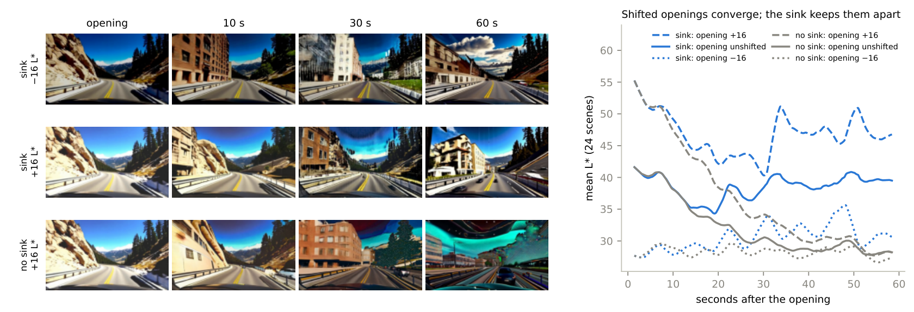
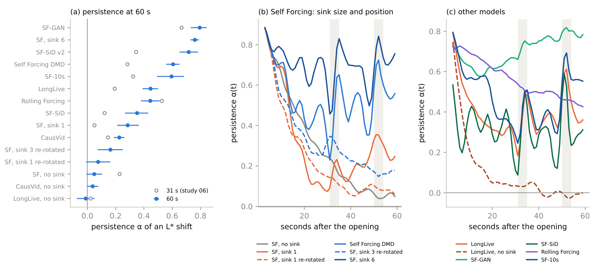
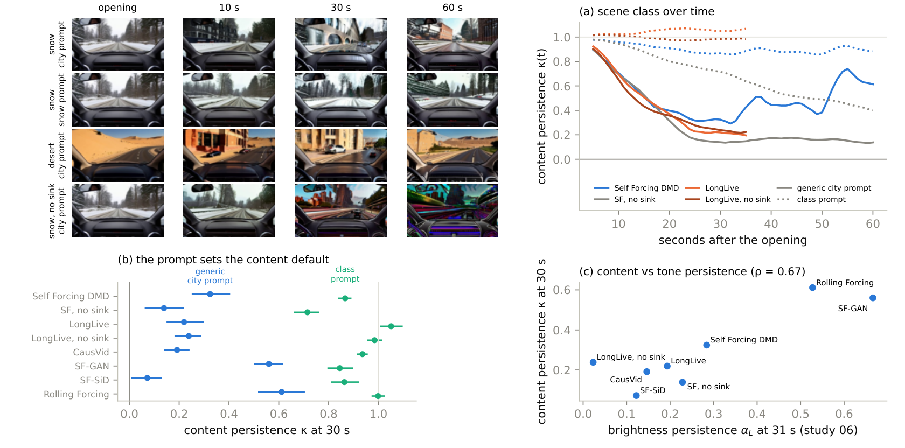
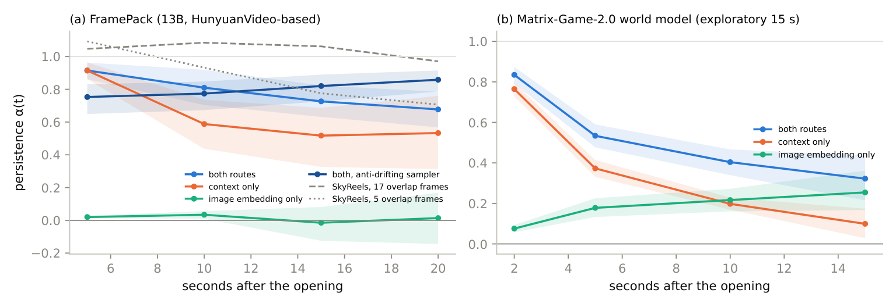
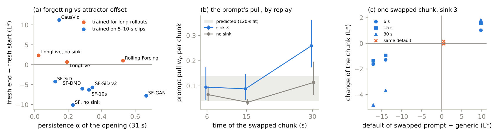

# Drift to Default

**How autoregressive video rollouts forget their opening.** Long autoregressive video rollouts relax: their tone and their scene content move from the opening toward a default set by the conditioning, keeping a model-specific share of where they started. This repository measures how much survives and what decides it, across seven open models (Wan-based cache models, SkyReels-V2, the 13B FramePack and the Matrix-Game-2.0 world model). Fifteen studies were preregistered before their videos existed; all 42 primary tests are reported, including the 15 that failed.

[](paper/main.pdf)
[](docs/README.md#preregistrations)
[](paper/main.pdf)
[](LICENSE)


<sub>A generated mountain-road opening, darkened or brightened by 16 L\*, continued for 60 s under a generic city prompt by Self Forcing with and without an attention sink. The scene becomes a city street in every run; without a sink the colours also blow out. Right: across 24 scenes, the three versions converge without a sink and stay apart with one.</sub>

## Overview

Autoregressive ("causal") video diffusion models generate a video a few frames at a time, each chunk conditioned on the model's own earlier output. This makes long, streaming generation possible, which world models need, and it makes the picture drift.

This study measures drift by **intervention**. It holds an opening frame, shifts its brightness, colour or scene class *within* a scene, lets the model continue, and asks how much of the shift survives. It uses the design tools of clinical research: paired seeds pinned to one GPU architecture, held-out prompts, cluster-bootstrap intervals, and analysis code frozen by hash before the data existed. About **12,000 videos** were generated on a university GPU cluster. No model was trained.

The core description is a relaxation law,

&nbsp;&nbsp;&nbsp;&nbsp;**x<sub>∞</sub> ≈ α · x<sub>opening</sub> + (1 − α) · μ**

where **α** is the share of the opening that is kept and **μ** is the default the conditioning pulls toward. Written this way it is just a linear response; the findings below are about which parts of it carry content.

## Key findings

| | Finding | Evidence | Status |
|---|---|---|---|
| 1 | **Every cache model relaxes, in tone and in scene content.** | Brightness persistence at 60 s ranges from −0.01 (LongLive, no sink) to 0.79 (Self Forcing GAN) across 15 cache configurations. Under a generic city prompt, snow, desert, forest, coast, mountain and farmland openings lose 39–93% of their CLIP class evidence within 30 s; under their own prompt they keep it (+9.3 log-odds, +9.0 after tone normalisation). | Preregistered (06, 07, 09, 10) |
| 2 | **An attention sink keeps a share that grows with its depth and depends mostly on its position.** | 60 s: no sink 0.05, one latent frame 0.29, three 0.61, six 0.76. Re-rotating the sink keys to sit just before the window cuts persistence from 0.61 to 0.16 and removes periodic bursts (at ~32 and ~52 s) in which the opening, including its scene content, returns. | Preregistered (07, 10) |
| 3 | **Keeping the opening in every segment's conditioning keeps more.** | FramePack (13B, HunyuanVideo-based), which places the opening as a clean prefix in every section, keeps 0.68 at 20 s (context prefix alone: 0.53). SkyReels-V2, which re-denoises 17 overlapping frames, keeps ~1.0 and relaxes once the overlap is cut to 5 frames (−0.24 [−0.40, −0.09]). | Preregistered (08, 11) |
| 4 | **The default is set by the conditioning.** | Lighting words: sunny 43, overcast 34, dusk 19, night 16 L\* on Self Forcing (45/40/32/21 on LongLive). Scene words decide whether a snowy opening stays snowy. In the Matrix-Game-2.0 world model (no text), the rollout drifts toward its CLIP image embedding; FramePack's SigLIP embedding, by contrast, carries no tone. | Preregistered (09, 11, 15) + exploratory |
| 5 | **Persistence depends on the prompt and replicates outside driving.** | Park, drone, kitchen and market scenes: Self Forcing sink 0.55 vs no sink 0.02 at 60 s; LongLive 0.24 vs 0.05; persistence differs between scene types (p = 0.049; LongLive p = 0.009). | Preregistered (12) |
| 6 | **Drift has two separable parts:** forgetting the opening, and an offset of the default from where the prompt starts. | Fresh rollouts drift 0.7–2.3 L\* in models trained for long rollouts (LongLive, Rolling Forcing) and 4–11 L\* in models trained on 5–10-s clips; all of them forget openings. | Exploratory |
| 7 | **A chunk recursion predicted the prompt's per-chunk pull; replay measured it.** | Predicted 0.08 from a 120-s fit; bit-exact KV-cache replay with only the text swapped measures w<sub>p</sub> = 0.088 [0.045, 0.149]. The recursion holds for ~20 s; later the pull triples and positional effects take over. | Preregistered (14) |
| 8 | **Training-free levers act on the two terms, at different costs.** | A content-aware correction (step 1 of 4) cuts colour drift by 1.48 and keeps 83% of legitimate brightness changes. A deeper sink (9 frames) cuts it by 1.93 with less flicker but keeps only 59%. Lighting words calibrated to measured defaults cut drift by 26% on Self Forcing; five other prompt tests failed. | Preregistered (02, 03–05, 13) |
| 9 | **An action-conditioned world model collapses near its training length.** | Matrix-Game-2.0 turned black within 30 s in 40 of 144 rollouts (mostly after 19 s), which limited its preregistered analysis (1 of 3 tests supported; all three hold at 15 s, exploratory). | Preregistered (15) |


<sub>Persistence at 60 s (study 10). (b) Sinks at their original rotary positions (solid) produce bursts at 31–35 s and 50–54 s (shaded); re-rotated sinks (dashed) do not, and keep far less.</sub>


<sub>Scene content (study 9). Under a generic city prompt, snow and desert openings become city streets; under their own prompt they stay. With a sink the desert comes back at 60 s, in the same positional burst.</sub>


<sub>Two models that receive the opening through a context route and an image-embedding route (studies 11 and 15).</sub>


<sub>(a) Forgetting vs attractor offset. (b, c) The prompt's per-chunk pull, measured by swapping only the text conditioning of one chunk from an identical cache (study 14).</sub>

## Study design

Every experiment compares arms on the **same openings or prompts, with the same seeds, on the same GPU architecture**; in bf16 the GPU type changes the output (see [Lessons](#lessons-for-evaluating-video-models)).

| Part | Question | Design | Videos | Preregistration | Notes |
|---|---|---|---|---|---|
| 1 | How do rolling windows and attention sinks affect drift? | 10 strategies × 40 prompts × 4 seeds, 31 s | 2,000 | [01](docs/preregistrations/01_context_strategies.md) | [02](docs/lab-notes/02_context_strategies_results.md) |
| 2 | Can drift be corrected at inference time? | Developed on 16 prompts, confirmed on 40 held-out prompts and 8 held-out transition prompts | ~1,200 | [02](docs/preregistrations/02_correction.md) | [03](docs/lab-notes/03_correction_development.md), [04](docs/lab-notes/04_correction_results.md) |
| 3 | What is drift? | Held real (NAVSIM) and generated openings; KV-cache interventions | ~400 | — | [05](docs/lab-notes/05_mechanism_and_real_openings.md) |
| 4 | Does the prompt set the default? | 40 openings × 4 lighting prompts; LongLive replication | ~1,250 | — | [06](docs/lab-notes/06_prompt_default_and_longlive.md) |
| 5 | Does describing the opening help? | 40 new openings × 5 arms × 2 models | 800 | [03](docs/preregistrations/03_matched_prompts.md) | [07](docs/lab-notes/07_matched_prompts_results.md) |
| 6 | Does a brightness-calibrated description help? | Same openings, 3 new arms, calibrated per model | ~670 | [04](docs/preregistrations/04_calibrated_lighting.md), [05](docs/preregistrations/05_calibrated_lighting_longlive.md) | [08](docs/lab-notes/08_calibrated_lighting_results.md), [09](docs/lab-notes/09_calibrated_lighting_longlive_results.md) |
| 7 | How much of an opening survives, across models? | 24 scenes × 7 shifted openings × 14 configurations, fresh starts, 120-s subset; SkyReels on 12 scenes | ~2,500 | [06](docs/preregistrations/06_relaxation.md) | [11](docs/lab-notes/11_relaxation_exploratory_addendum.md)–[13](docs/lab-notes/13_relaxation_results.md) |
| 8 | Does the sink hold the opening at 60 s? | 24 scenes × 3 openings × sink on/off × Self Forcing, CausVid | 288 | [07](docs/preregistrations/07_long_horizon_sink.md) | [14](docs/lab-notes/14_long_horizon_sink_results.md) |
| 9 | Does a weaker overlap make diffusion forcing relax? | 12 new scenes × overlap 5 / 17 × ±16 L\*, SkyReels | 48 | [08](docs/preregistrations/08_skyreels_overlap.md) | [15](docs/lab-notes/15_skyreels_overlap_results.md) |
| 10 | Does scene content relax? | 24 class openings × city vs class prompt × 8 configurations, CLIP class scores | 448 | [09](docs/preregistrations/09_content_relaxation.md) | [17](docs/lab-notes/17_content_relaxation_results.md) |
| 11 | Persistence of every model at 60 s; sink depth and position | 24 scenes × 13 configurations incl. sink 1/6 and re-rotated sinks | 792 | [10](docs/preregistrations/10_persistence_atlas.md) | [23](docs/lab-notes/23_atlas_results.md) |
| 12 | A non-Wan model: FramePack | 12 scenes × context / embedding / both routes + anti-drifting sampler | 96 | [11](docs/preregistrations/11_framepack_channels.md) | [22](docs/lab-notes/22_framepack_results.md) |
| 13 | Do the findings hold outside driving? | 24 openings in park, drone, kitchen, market scenes × sink on/off × 2 models | 288 | [12](docs/preregistrations/12_prompt_generality.md) | [20](docs/lab-notes/20_prompt_generality_results.md) |
| 14 | Deeper sinks as a baseline for the correction | Confirmation set of Part 2 with 6- and 9-frame sinks | 384 | [13](docs/preregistrations/13_deep_sink_baseline.md) | [21](docs/lab-notes/21_deep_sink_results.md) |
| 15 | The prompt's per-chunk pull, by replay | 16 seeds × 2 sink settings × 3 times × 5 prompts | 32 + replays | [14](docs/preregistrations/14_prompt_pull_replay.md) | [16](docs/lab-notes/16_prompt_pull_results.md) |
| 16 | An action-conditioned world model | Matrix-Game-2.0, 24 scenes × context / embedding / both routes | 144 | [15](docs/preregistrations/15_world_model.md) | [19](docs/lab-notes/19_world_model_results.md) |

Exploratory re-analyses requested by an internal review (drift decomposition, prompt dependence, intervals for retention) are in [lab note 18](docs/lab-notes/18_review_analyses.md).

**Metrics.** Persistence α is the within-scene slope of the end value (a window before the endpoint) on the opening value, over shifted versions of the same opening. Content persistence κ is the same quantity for the CLIP log-odds of the opening's scene class against "a city street", normalised between the opening (1) and fresh generic rollouts (0). For prompt-only rollouts, drift D (Mahalanobis distance of colour statistics) and K (DINOv2 nearest-neighbour distance) are measured against 10 fresh 5-s generations of the same prompt.

## Measuring α and μ for your own model

1. **Pick openings.** Choose 10–24 opening images. For each, write versions shifted in CIELAB L\* by −16, 0 and +16 (`--open_dL` in `generation/hold_gen.py`; for other code bases copy the short shift in its `init_latent_from_image`).
2. **Continue them** for 30–60 s with one prompt and one seed. Keep all versions of an opening in one job on one GPU architecture (`generation/arch_guard.py`).
3. **Estimate α** as the within-opening slope of end brightness on opening brightness (`analysis/analyze_atlas.py`). Report it at a long horizon: 31-s values can be transients.
4. **Estimate μ** from the zero-drift level of step 3 or from where fresh rollouts of the same prompt end (they correlate at r = 0.93, but the fresh end is only a rough guide).
5. **Check the sink's positions.** If your model keeps a sink at absolute rotary positions, look for bursts in α(t); they are positional, not memory.
6. **Predict a prompt change** as (1 − α)(μ − opening), with μ measured per candidate prompt and per model.

## What did not hold

- **15 of 42 preregistered primary tests failed** (full table in the paper's appendix): all four caption-prompt tests, five of six calibrated-lighting tests, the Self Forcing sink at 31 s (it holds at 60 s), LongLive's sink on scene content, two of three FramePack tests (its image embedding carries no tone), and two of three world-model tests (underpowered by collapse).
- **One quantitative prediction missed:** the recursion predicted a Self Forcing plateau of 0.25–0.54; it was 0.58, largely because of positional bursts.
- **Withdrawn during the study:** that the sink stabilises the default; that the model follows its context by 75% (true only for artificial shifts); that early dynamics forecast the final brightness; that MUSIQ rewards collapsed videos.

## Lessons for evaluating video models

- **The GPU architecture changes the video.** With bf16, the same seed gives bit-identical output within an architecture but different videos on A40, A100/A800 and L40S/RTX 6000 Ada. Paired comparisons must pin or guard the architecture; in Part 1, 62% of the nominal pairs ran on different architectures.
- **A resumed job can silently break pairing.** Generators that skip existing outputs resume a preempted job wherever it lands; `generation/arch_guard.py` regenerates a task's outputs if that happens.
- **Measure at the right horizon.** Self Forcing without a sink has not yet forgotten at 31 s; with a sink, persistence at 31 s is in a trough between positional bursts.
- **Common quality metrics miss this drift.** MUSIQ, behind VBench's imaging-quality score, is nearly flat across strategies that differ threefold in drift.
- **Natural variation is too small to estimate persistence.** Within a prompt, seeds start only ~2 L\* apart; controlled shifts are needed.

## Reproducing

**Re-checking the published analysis** needs only the files in this repository:
```bash
pip install -r requirements.txt
python analysis/verify_preregistration.py   # frozen analysis code matches the preregistered hashes
python report/make_v2_figs.py               # redraws the figures of the second round from results/
```

**Re-running generation** needs a GPU and the public weights of each model: [Self Forcing](https://github.com/guandeh17/Self-Forcing) (patched by `cluster/patch_sf.py`), [LongLive](https://github.com/NVlabs/LongLive), [Rolling Forcing](https://github.com/TencentARC/RollingForcing), CausVid, SkyReels-V2-DF-1.3B and FramePack through diffusers, and [Matrix-Game-2.0](https://github.com/SkyworkAI/Matrix-Game) (with the PyTorch stand-in for flash-attention in `generation/shims/`). Each script in `generation/` documents its arguments; task builders in `analysis/make_*_tasks.py` give the exact commands used. NAVSIM / nuPlan frames used as real openings are not redistributed; `prompts/` lists the log and frame for each.

## Repository layout

```
generation/   video generation for every model, held and shifted openings, KV-cache replay, CLIP and DINOv2 features
analysis/     one script per experiment (preregistered ones frozen), task builders, verify_preregistration.py
prompts/      all prompt sets
results/      summary JSON and tables for every experiment (index: results/README.md)
paper/        paper (LaTeX + PDF) and its figures
report/       figure scripts, frame tiles for the qualitative figures, and an earlier technical report
docs/         preregistrations (Chinese originals, English translations) and lab notes (index: docs/README.md)
cluster/      environment setup and runtime patches for the SGE cluster
tools/        GIFs and contact sheets
```

## Citation

```bibtex
@misc{wang2026drifttodefault,
  title  = {Drift to Default: How Autoregressive Video Rollouts Forget Their Opening},
  author = {Wang, Yilin},
  year   = {2026},
  url    = {https://github.com/ElaineYilinW/drift-to-default}
}
```

## License and acknowledgements

The code in this repository is released under the [MIT License](LICENSE). It drives and patches Self Forcing, LongLive, Rolling Forcing, CausVid, SkyReels-V2, FramePack and Matrix-Game-2.0, and uses Wan2.1, HunyuanVideo, CLIP, DINOv2, pyiqa and Qwen2.5-VL, each under its own licence. NAVSIM / nuPlan images are not redistributed. Computation ran on the University of Iowa Argon cluster.

This is an independent study and is not affiliated with any company.
